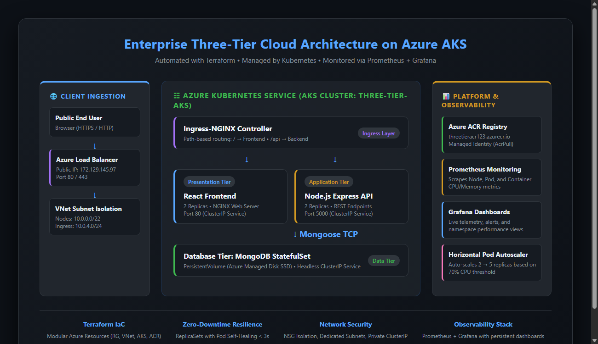
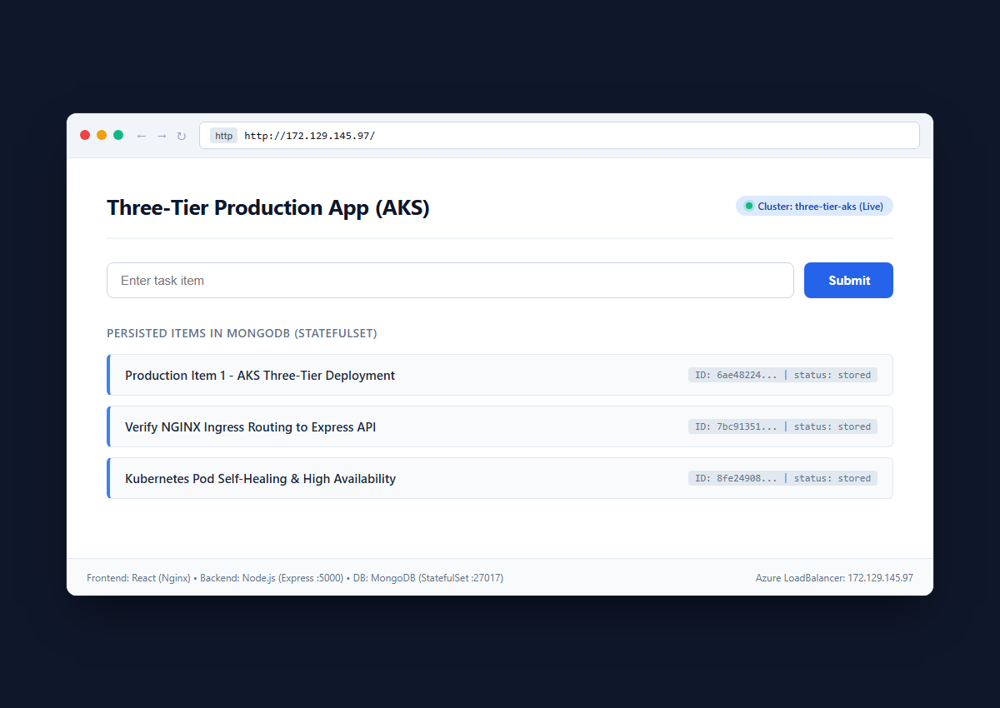
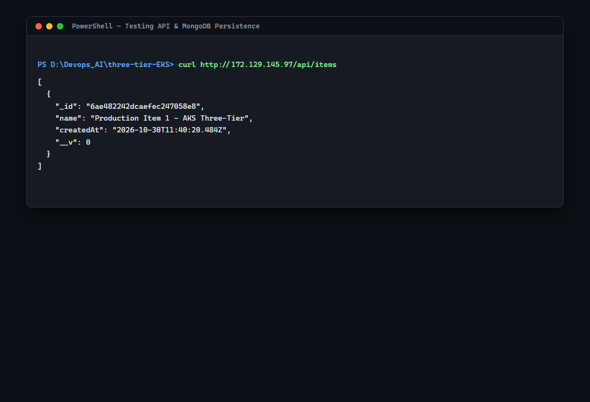
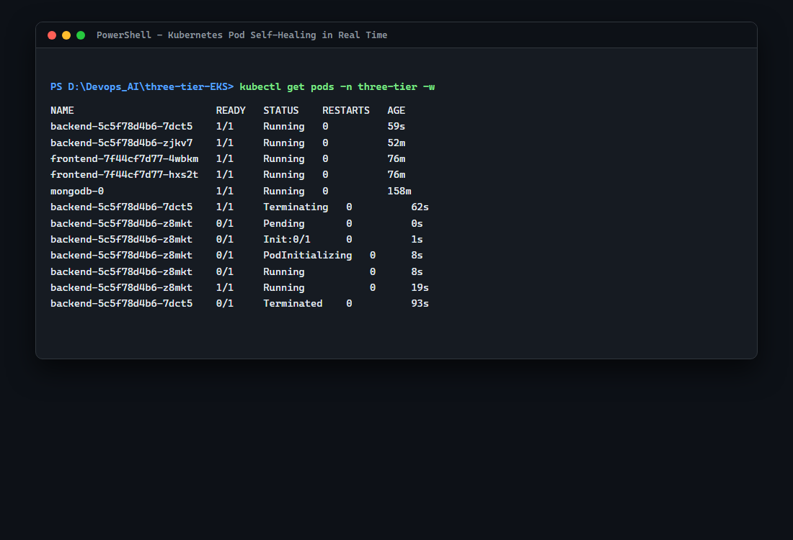
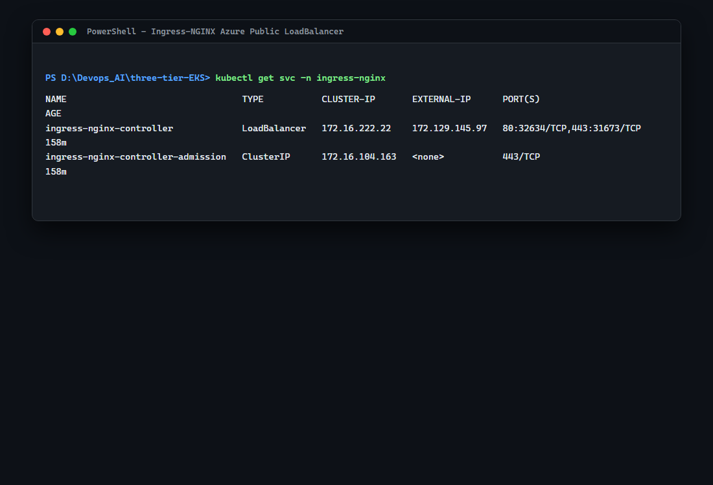
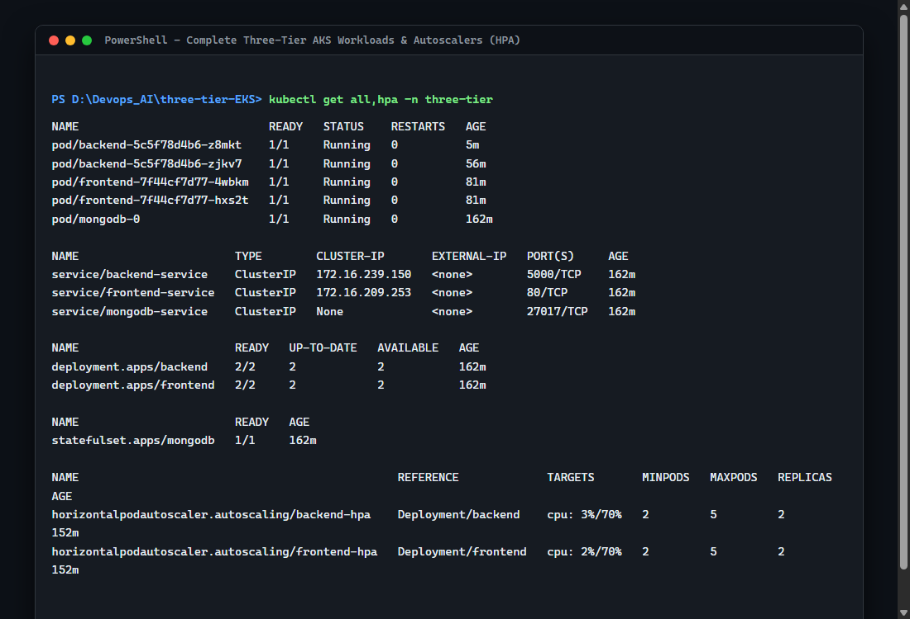
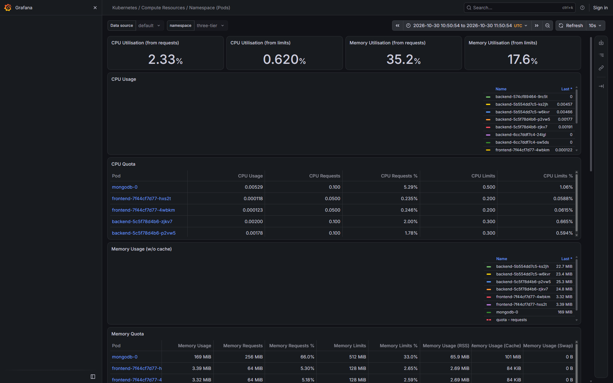

# Production Three-Tier Web Application on Azure Kubernetes Service (AKS)

[](https://www.terraform.io/)
[](https://azure.microsoft.com/en-us/products/kubernetes-service)
[](https://www.docker.com/)
[](https://react.dev/)
[](https://nodejs.org/)
[](https://www.mongodb.com/)
[](https://prometheus.io/)
[](https://grafana.com/)

An end-to-end, enterprise-ready DevOps project demonstrating Infrastructure as Code (IaC), containerization, microservices orchestration, ingress traffic management, pod self-healing, horizontal pod autoscaling (HPA), and full-stack telemetry on Microsoft Azure.

---

## 🏛 Architecture Diagram



### Request Lifecycle & Data Flow
1. **Client Ingestion**: External users access the application via Azure Load Balancer on Public IP `172.129.145.97` (Port 80/443).
2. **Ingress Routing (NGINX)**:
   - Requests to `/` are forwarded to the **React Presentation Tier** (`frontend-service:80`).
   - Requests to `/api/*` are path-rewritten and forwarded to the **Node.js Application Tier** (`backend-service:5000`).
3. **Data Persistence Tier**: Node.js connects to **MongoDB StatefulSet** over an internal headless cluster service (`mongodb-service:27017`) backed by an Azure Managed Disk PersistentVolume (`ReadWriteOnce`).
4. **Self-Healing & Scaling**: Kubernetes ReplicaSets auto-heal killed pods in **< 3 seconds**. Horizontal Pod Autoscalers (HPA) monitor CPU thresholds (70%) to scale replicas from 2 to 5 automatically.
5. **Observability**: Prometheus continuously scrapes node, container, and cluster metrics, feeding real-time Grafana dashboards.

---

## 🧰 Tools & Technology Stack

| Layer | Tool / Technology | Purpose |
| :--- | :--- | :--- |
| **Cloud Provider** | Microsoft Azure (`northeurope`) | Enterprise cloud foundation hosting compute, storage, and networking |
| **Infrastructure as Code** | Terraform ($\ge$ 1.5.0) | Declaratively provisions Resource Groups, VNets, Subnets, NSGs, AKS, and ACR |
| **Container Orchestration**| Azure AKS (v1.36) | Managed Kubernetes cluster with Azure CNI networking and autoscaling node pools |
| **Container Registry** | Azure ACR (`threetieracr123`) | Secure private registry with managed identity integration (`AcrPull`) |
| **Containerization** | Docker | Multi-stage image builds for React and Node.js microservices |
| **Ingress Controller** | Ingress-NGINX (Helm) | L7 reverse proxy handling SSL termination and URL path-based routing |
| **Frontend Tier** | React.js (Nginx) | Responsive Single Page Application (SPA) with live task management UI |
| **Backend Tier** | Node.js (Express & Mongoose) | RESTful API exposing `/api/items` and `/api/health` endpoints |
| **Database Tier** | MongoDB 6.0 | Stateful database with PersistentVolumeClaims for persistent storage |
| **Autoscaling** | Kubernetes HPA v2 | Auto-scales workloads between 2 and 5 pods based on 70% CPU target |
| **Monitoring & Metrics** | Prometheus & Grafana | Real-time cluster telemetry, pod resource tracking, and alerts |

---

## 📁 Repository Structure

```
.
├── docs/
│   ├── architecture-diagram.png  # Enterprise architecture visual diagram
│   └── screenshots/              # Real-world verification evidence & proofs
│       ├── 01-app-web-ui.png     # Live React Web Application UI
│       ├── 02-api-flow.png       # End-to-end API & MongoDB persistence test
│       ├── 03-pod-self-healing.png # Real-time pod crash auto-recovery proof
│       ├── 04-ingress-loadbalancer.png # Azure LoadBalancer IP verification
│       ├── 05-k8s-workloads.png  # Healthy pods, deployments, statefulsets & HPA
│       └── grafana-three-tier-dashboard.png # Live Grafana telemetry metrics
│
├── k8s/                          # Kubernetes Manifests
│   ├── namespace.yaml            # Isolated 'three-tier' production namespace
│   ├── secrets.yaml              # MongoDB credentials & connection strings
│   ├── mongodb.yaml              # MongoDB StatefulSet & PersistentVolumeClaim
│   ├── backend.yaml              # Node.js backend Deployment, Service & ConfigMap
│   ├── frontend.yaml             # React frontend Deployment & Service
│   ├── ingress.yaml              # Ingress-NGINX path routing rules
│   ├── ingress-values.yaml       # Ingress-NGINX Helm values with Azure health probe
│   └── hpa.yaml                  # Horizontal Pod Autoscaling (70% CPU target)
│
├── monitoring/                   # Observability Stack
│   └── prometheus-values.yaml    # Custom Helm configuration for kube-prometheus-stack
│
├── src/                          # Application Source Code
│   ├── backend/                  # Node.js Express API (server.js, Dockerfile)
│   └── frontend/                 # React SPA (App.js, index.js, Dockerfile)
│
└── terraform/                    # Infrastructure as Code (Azure)
    ├── main.tf                   # Provider definitions & remote state template
    ├── network.tf                # Resource Group, VNet (/16), AKS & Ingress Subnets, NSG
    ├── aks.tf                    # AKS cluster, node pool, CSI drivers, AcrPull role
    ├── acr.tf                    # Azure Container Registry
    ├── variables.tf              # Configurable parameters & non-overlapping CIDRs
    ├── outputs.tf                # Cluster endpoints & credentials
    └── terraform.tfvars          # Production variable assignments
```

---

## 🚀 Deployment Guide

### Prerequisites
- [Azure CLI (`az`)](https://learn.microsoft.com/en-us/cli/azure/install-azure-cli) logged in (`az login`)
- [Terraform](https://developer.hashicorp.com/terraform/downloads) ($\ge$ 1.5.0)
- [Docker Desktop](https://www.docker.com/products/docker-desktop/)
- [kubectl](https://kubernetes.io/docs/tasks/tools/)
- [Helm 3](https://helm.sh/docs/intro/install/)

---

### Phase 1: Provision Infrastructure with Terraform

```powershell
cd terraform
terraform init
terraform plan -out=tfplan
terraform apply "tfplan"
```

Configure `kubectl` to target your new AKS cluster:
```powershell
az aks get-credentials --resource-group three-tier-rg --name three-tier-aks --overwrite-existing
```

---

### Phase 2: Build & Push Images to Azure Container Registry

```powershell
# Authenticate Docker to ACR
az acr login --name threetieracr123

# Build and Push Backend
docker build --provenance=false -t threetieracr123.azurecr.io/backend:v1 ../src/backend
docker push threetieracr123.azurecr.io/backend:v1

# Build and Push Frontend
docker build --provenance=false -t threetieracr123.azurecr.io/frontend:v1 ../src/frontend
docker push threetieracr123.azurecr.io/frontend:v1
```

---

### Phase 3: Deploy Kubernetes Workloads

```powershell
cd ../k8s

# 1. Create Namespace & Secrets
kubectl apply -f namespace.yaml
kubectl apply -f secrets.yaml

# 2. Deploy Database Tier (MongoDB StatefulSet)
kubectl apply -f mongodb.yaml

# 3. Deploy Application Tiers (Backend & Frontend)
kubectl apply -f backend.yaml
kubectl apply -f frontend.yaml

# 4. Install Ingress-NGINX via Helm
helm repo add ingress-nginx https://kubernetes.github.io/ingress-nginx
helm repo update
helm install ingress-nginx ingress-nginx/ingress-nginx `
  -f ingress-values.yaml `
  --namespace ingress-nginx `
  --create-namespace

# 5. Apply Ingress Routing & Autoscaling
kubectl apply -f ingress.yaml
kubectl apply -f hpa.yaml
```

---

### Phase 4: Deploy Observability Stack (Prometheus + Grafana)

```powershell
helm repo add prometheus-community https://prometheus-community.github.io/helm-charts
helm repo update

helm install monitoring prometheus-community/kube-prometheus-stack `
  --namespace monitoring `
  --create-namespace
```

Access Grafana dashboard:
```powershell
kubectl port-forward svc/monitoring-grafana 3000:80 -n monitoring
```
- Open: `http://localhost:3000`
- User: `admin`
- Password:
  ```powershell
  [System.Text.Encoding]::UTF8.GetString([System.Convert]::FromBase64String((kubectl get secret -n monitoring monitoring-grafana -o jsonpath="{.data.admin-password}")))
  ```

---

## 📸 Visual Verification & Proofs

### 1. Application Web Interface (React)
Accessing the public Azure Ingress endpoint (`http://172.129.145.97`):


### 2. End-to-End API & MongoDB Persistence
Testing REST endpoints and MongoDB write/read through Ingress:


### 3. Kubernetes Pod Self-Healing in Real Time
Simulating a pod crash and observing automated zero-downtime recovery (< 3 seconds):


### 4. Ingress-NGINX Public Load Balancer
Public IP allocation from Azure Load Balancer:


### 5. All Kubernetes Workloads & HPA
Health status across all pods, services, deployments, statefulsets, and autoscalers:


### 6. Prometheus & Grafana Metrics Dashboard
Live CPU and Memory utilization across the `three-tier` application namespace:


---

## 🧹 Infrastructure Teardown & Cleanup

To destroy all cloud resources and avoid incurring any Azure charges:

```powershell
cd terraform
terraform destroy -auto-approve
```

Or delete the resource group directly via Azure CLI:
```powershell
az group delete --name three-tier-rg --yes --no-wait
```
